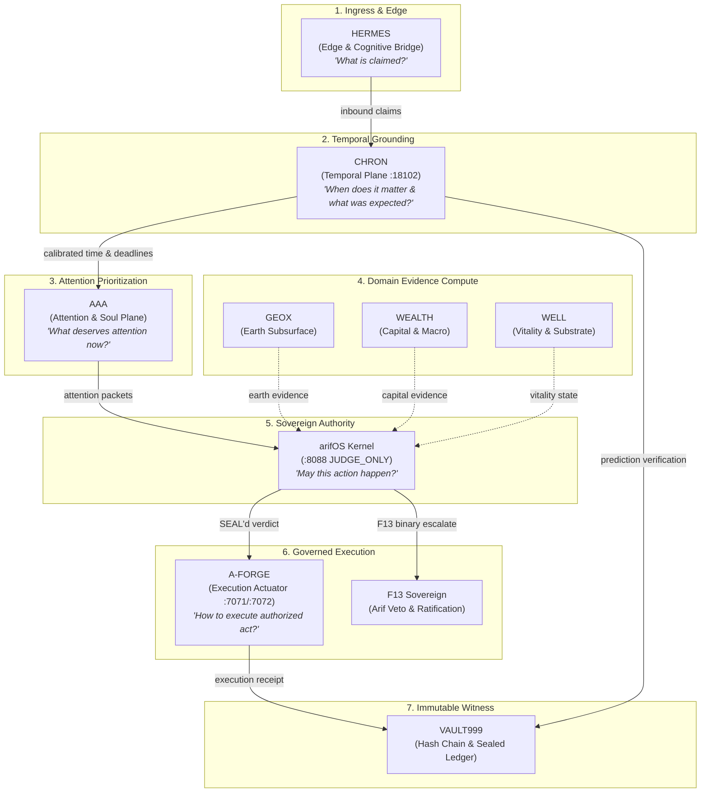

<!-- SOT-MANIFEST
owner: Muhammad Arif bin Fazil (F13 SOVEREIGN)
federation_release: v2026.09.27
last_verified: 2026-09-27T11:25:00Z
organ: CHRON
role: temporal_consequence_tracker
doctrine: "Demi masa. Time is the witness. CHRON is the temporal cortex — predicts, verifies, calibrates, learns. Not a scheduler. Not a memory store."
authority_ceiling: 555_COMPUTE_ONLY
port: 18102
mcp_port: 18102
unit: chron-mcp.service
public_mcp: https://chron.arif-fazil.com/mcp
truth_rule: live :18102/health + tools/list beat any static count in prose
apex_zen: HERMES claims → CHRON temporal → AAA attention → arifOS authority → A-FORGE execution
-->

# CHRON — Temporal Intelligence & Calibration Engine

[](http://127.0.0.1:18102/health)
[](#authority--governance)
[](http://127.0.0.1:18102/health)
[](./LICENSE)

> **"Demi masa. Sesungguhnya manusia itu benar-benar dalam kerugian, kecuali orang-orang yang beriman dan mengerjakan kebajikan serta saling menasihati untuk kebenaran dan saling menasihati untuk kesabaran."** *(Surah Al-'Asr 103:1-3)*
>
> **Time is the ultimate witness.** Intelligence without temporal grounding is hallucination.

CHRON is the **temporal cortex** of the arifOS Federation. It anchors intelligence in the flow of time by recording expectations, measuring calibration, closing learning loops, and computing attention debt.

**CHRON is not a cron scheduler. It is not an archive. It is the organ that verifies whether predictions actually came true.**

---

## The Irreducible Question

> *"When does this matter, and what did we expect to happen?"*

Without CHRON, agents make assertions without deadlines and evaluate models without scoring their predictions. CHRON forces every hypothesis to state its temporal window and holds it accountable against observed reality.

---

## Position in the Federation Flow

CHRON operates between perceptual ingress ([HERMES](https://github.com/ariffazil/HERMES)) and attention prioritization ([AAA](https://github.com/ariffazil/AAA)), feeding time-calibrated expectations into the sovereign governance loop:



---

## Core Capabilities

| Capability | Module | Description |
|---|---|---|
| **Prediction Ledger** | [`chron_prediction.py`](./chron_prediction.py) | Registers structured, falsifiable predictions with probability, confidence interval, and verification window |
| **Calibration & Brier Scoring** | [`chron_learn.py`](./chron_learn.py) | Computes empirical Brier scores, calibration curves, and drift over time |
| **Learning Loop Closure** | [`chron_loop_close.py`](./chron_loop_close.py) | Automatically compares past expectations with actual outcomes; seals lessons into ledger |
| **Temporal Verification** | [`verify_due.py`](./verify_due.py) | Scheduled sweep verifying predictions whose deadline window has expired |
| **Attention Debt** | [`chron_attention_debt.py`](./chron_attention_debt.py) | Tracks open loops, unresolved promises, and cognitive latency across the federation |
| **arifFlow Bridge** | [`chron_ariflow_bridge.py`](./chron_ariflow_bridge.py) | Streams temporal events and loop closures to arifFLOW metabolism plane |

---

## Canonical MCP Tools (Port 18102)

CHRON exposes 8 FastMCP tools under authority ceiling `555_COMPUTE_ONLY`:

1. `chron_predictions_due`: Lists predictions currently ready for reality verification.
2. `chron_calibration_state`: Returns aggregate Brier score, accuracy, and calibration drift metrics.
3. `chron_last_loop`: Retrieves the most recent closed learning loop and its epistemic delta.
4. `chron_active_events`: Queries currently open temporal events and timeline horizons.
5. `chron_active_predictions`: Lists active, unfalsified predictions currently under observation.
6. `chron_store_stats`: Reports store health, total recorded episodes, and ledger counts.
7. `chron_temporal_briefing`: Generates a compact temporal situation report for agent session init.
8. `chron_generate_predictions`: Formulates new testable predictions from proposed agent actions.

---

## Systemd Units & Timers

```bash
# Service
systemctl status chron-mcp.service       # FastMCP server on 127.0.0.1:18102

# Background verification & loop closing timers
systemctl list-timers | grep chron
# chron-task0-reconciliation.timer  (06:50 MYT)
# chron-prediction-verifier.timer   (07:00 MYT)
# chron-loop-closer.timer           (07:15 MYT)
```

---

## Federation Integration & Flow

- **Inbound from [HERMES](https://github.com/ariffazil/HERMES):** Claims made in conversations or external reports are stamped with temporal horizons.
- **Outbound to [AAA](https://github.com/ariffazil/AAA):** Deadlines and attention debt feed directly into AAA's Attention formula `P = (Impact × Urgency × EvidenceQuality × Novelty) / AttentionCost`.
- **Witnessed by [arifOS](https://github.com/ariffazil/arifOS):** Calibration metrics provide empirical weights for constitutional floor F2 (`EVIDENCE_INTEGRITY`).
- **Executed by [A-FORGE](https://github.com/ariffazil/A-FORGE):** Automated verifiers run via governed cron jobs and background tasks.

---

## License

AGPL-3.0 — arifOS Federation.
DITEMPA BUKAN DIBERI.

<!-- FEDERATION-STANDARD v2026-10-15 START :: 333-AGI audit :: source: organs.yaml + git + live probes :: regenerate: re-run audit -->
## 🔗 Federation Identity (auto-audit 2026-10-15)
| Field | Value |
|---|---|
| Organ | `chron` · METABOLISM · temporal_consequence_tracker |
| Ports | 18102 (/mcp) |
| Unit | chron-mcp.service |
| Authority ceiling | COMPUTE_ONLY |
| Live (SOT probe @audit) | UP (/health 0.76-1.59s, tiada cache @audit) |
| Repo HEAD @audit | `7931573 2026-10-08` |
| Public MCP | https://chron.arif-fazil.com/mcp |
| Rollback | — |
| Flow graph | [FEDERATION-FLOW-GRAPH.md](../FEDERATION-FLOW-GRAPH.md) — peta semua organ + repo |
<!-- FEDERATION-STANDARD v2026-10-15 END -->
