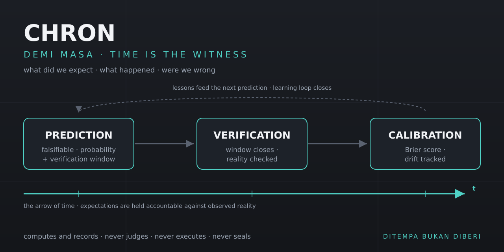

<!-- SOT-MANIFEST
owner: Muhammad Arif bin Fazil (F13 SOVEREIGN)
federation_release: v2026.09.27
last_verified: 2026-09-27T11:25:00Z
organ: CHRON
role: temporal_consequence_tracker
doctrine: "Demi masa. Time is the witness. CHRON is the temporal cortex — predicts, verifies, calibrates, learns. Not a scheduler. Not a memory store."
authority_ceiling: 555_COMPUTE_ONLY
port: 18102
mcp_port: 18102
unit: chron-mcp.service
public_mcp: https://chron.arif-fazil.com/mcp
truth_rule: live :18102/health + tools/list beat any static count in prose
apex_zen: HERMES claims → CHRON temporal → AAA attention → arifOS authority → A-FORGE execution
-->

<p align="center"></p>

# CHRON

**Predict. Verify. Learn.** · *Demi masa.*

CHRON is the temporal consequence tracker of the arifOS federation: it records falsifiable predictions with verification windows, checks them against observed reality when a window closes, and scores calibration over time.

[](#current-verified-state)
[](http://127.0.0.1:18102/health)
[](#role-invariant)
[](./LICENSE)

> ### Role invariant
> **Time is the witness.** CHRON computes and records; it never judges, never executes, never seals.
> It is a **boundary service, not a constitutional organ** — verdicts belong to [arifOS](https://github.com/ariffazil/arifOS), execution to [A-FORGE](https://github.com/ariffazil/A-FORGE), sealed receipts to VAULT999.
> **Not a cron scheduler. Not a memory store.** It answers one question: *did what we expected actually happen?*
>
> *“Demi masa. Sesungguhnya manusia itu benar-benar dalam kerugian…”* (Al-'Asr 103:1–3) — intelligence without temporal grounding is hallucination.

## What works today
*(all claims measured 2026-10-16 unless dated otherwise)*

- **Prediction ledger** — 128 predictions recorded (49 active, 38 verified, 4 unverifiable/closed) per live `/health`.
- **Calibration scoring** — empirical Brier score + Wilson CI over verified predictions; quality flag `SUFFICIENT` (self-measured — see gap below).
- **MCP surface live** at `:18102` — `tools/list` returned **21 tool names** at 2026-10-16T08:50Z (server banner itself claims "20 tools"; the discrepancy is the server's, not the README's).
- **Verification sweeps run** — 5 systemd timers active (`chron-task0-reconciliation`, `chron-prediction-verifier`, `chron-loop-closer`, `chron-reality-impact-attestor`, `chron-edge-midday`), last fired 2026-10-16.
- **Attention debt accounting** — open loops tracked with growth rate (72.2 across 10 items, +1.34/day).

## What is not yet proven

- **Calibration numbers are runtime self-report.** No independent audit of the scoring pipeline is on record. (Self-measurement ≠ independent audit.)
- **Learning-loop efficacy** — that lessons improve future predictions has no causal measurement.
- **`chron_frame_witness` bridge** (independent FRAME witness path) has no end-to-end evidence in this repo.
- **Unverifiable closure policy** — 2 predictions awaiting evidence, 2 closed untestable; the closure criteria have not been independently reviewed.

## 30-second proof

```bash
curl -s http://127.0.0.1:18102/health
```

Returns one JSON object — store counts, prediction accounting, calibration, attention debt — with `query_time` and cache age. Observed output (abridged, 2026-10-16T08:49:25Z):

```json
{"status":"ok","organ":"CHRON","port":18102,"episodes":199449,
 "predictions":{"total":128,"active":49,"verified":38},
 "calibration":{"total_verified":32,"mean_brier":0.1636,"quality":"SUFFICIENT"}}
```

Read-only. Full transcript discipline and the wider doctrine: [`docs/archive/README-2026-10-16-pre-doctrine.md`](./docs/archive/README-2026-10-16-pre-doctrine.md).

## What CHRON does (five jobs)

1. **File a falsifiable prediction** — `chron_generate_predictions` / `chron_create_event`: probability, confidence, and verification window, stated *before* the outcome.
2. **Ask what is due** — `chron_predictions_due`: which expectations can now be checked against reality.
3. **Score calibration** — `chron_calibration_state`: Brier score, accuracy + CI, drift over time.
4. **Track open loops** — `chron_attention_debt`: unresolved promises and cognitive latency across the federation.
5. **Brief a session** — `chron_temporal_briefing`: *when does this matter, and what did we expect?* — injected at agent session init.

## Current verified state

**Observed at 2026-10-16T08:49:25Z** — method: `curl -s http://127.0.0.1:18102/health` (runtime self-report; not an independent audit).

| Fact | Value |
|---|---|
| Status | `ok` · server `CHRON v4.1.0` (MCP initialize, 2026-10-16) |
| Episodes recorded | 199,449 |
| Predictions | 128 total · 49 active · 38 verified · 2 awaiting evidence · 2 closed untestable |
| Calibration | mean Brier 0.1636 · accuracy 0.831 (Wilson 95% CI 0.58–0.87) · n=32 · `SUFFICIENT` |
| Attention debt | 72.2 across 10 items · growth 1.34/day |

Dynamic state is generated by probe. **If this section conflicts with the live endpoint, the endpoint wins.**

## Development

- **Runtime:** `mcp_server.py` under `chron-mcp.service` (FastMCP on 127.0.0.1:18102). Public MCP: https://chron.arif-fazil.com/mcp
- **Modules:** [`chron_prediction.py`](./chron_prediction.py) · [`chron_verify.py`](./chron_verify.py) / [`verify_due.py`](./verify_due.py) · [`chron_learn.py`](./chron_learn.py) · [`chron_loop_close.py`](./chron_loop_close.py) · [`chron_attention_debt.py`](./chron_attention_debt.py) · [`chron_ariflow_bridge.py`](./chron_ariflow_bridge.py)
- **Tests:** `python test_learn_quality.py` · `python test_resolve_event.py` · `python chron_e2e_proof.py`
- **Timers:** `systemctl list-timers | grep chron`

## License & federation identity

AGPL-3.0 — arifOS Federation. **DITEMPA BUKAN DIBERI.**

<!-- FEDERATION-STANDARD v2026-10-15 START :: 333-AGI audit :: source: organs.yaml + git + live probes :: regenerate: re-run audit -->
## 🔗 Federation Identity (auto-audit 2026-10-15)
| Field | Value |
|---|---|
| Organ | `chron` · METABOLISM · temporal_consequence_tracker |
| Ports | 18102 (/mcp) |
| Unit | chron-mcp.service |
| Authority ceiling | COMPUTE_ONLY |
| Live (SOT probe @audit) | UP (/health 0.76-1.59s, tiada cache @audit) |
| Repo HEAD @audit | `7931573 2026-10-08` |
| Public MCP | https://chron.arif-fazil.com/mcp |
| Rollback | — |
| Flow graph | `/root/FEDERATION-FLOW-GRAPH.md` (on-box federation map — outside this repo; relative link removed 2026-10-16) |
<!-- FEDERATION-STANDARD v2026-10-15 END -->
