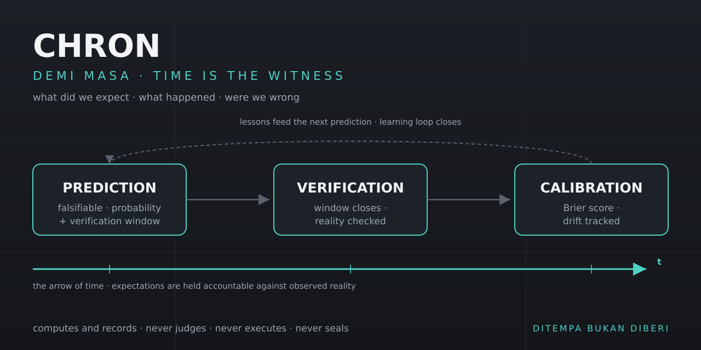
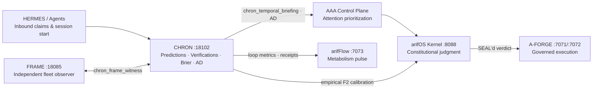

<!-- SOT-MANIFEST
owner: Muhammad Arif bin Fazil (F13 SOVEREIGN)
federation_release: v2026.11.18
last_verified: 2026-11-18T07:56:51Z
organ: CHRON
role: The Measure (Time) — temporal_consequence_tracker
doctrine: "Demi masa. Time is the witness. CHRON predicts, verifies, calibrates, and tracks attention debt. Never a scheduler. Never a memory owner."
authority_ceiling: 555_COMPUTE_ONLY
port: 18102
unit: chron-mcp.service
source_commit_main: 610b58d (19 @mcp.tool handlers on main)
live_runtime_surface: http://127.0.0.1:18102/mcp (24 MCP tools, 8 resources, 4 prompts on active host service)
public_health: https://chron.arif-fazil.com/health
public_mcp: https://chron.arif-fazil.com/mcp
public_llms: https://chron.arif-fazil.com/llms.txt
truth_rule: live :18102/health + MCP tools/list beat any static count in prose
-->

<p align="center">
  
</p>

# CHRON

### Predict. Verify. Calibrate. · *Demi masa.*

**CHRON is the temporal consequence tracker of the arifOS agentic federation.** It records falsifiable predictions with explicit verification horizons, checks outcomes against reality once windows close, scores empirical calibration (Brier score + Wilson 95% CI), and tracks unresolved attention debt (`AD`).

When agents execute without waiting for outcomes, confidence detaches from reality. CHRON anchors the federation to the arrow of time: *did what we expected actually happen?*

<!-- ═══════════════════════════════════════════════════════════════════════ -->
<!-- LANE 1: THE 60-SECOND HUMAN HORIZON                                     -->
<!-- ═══════════════════════════════════════════════════════════════════════ -->

## What is this?
CHRON tracks events, dated predictions, outcome verifications, empirical calibration scores, and attention debt (`AD`) across the arifOS system over HTTP/MCP on port `18102`.

## Why does it exist?
AI agents optimize for immediate plausibility and move on before consequences land. Without dated falsifiers, reality checks, and honest error tracking, systems mistake activity for accuracy.

## Who bears the consequence if this fails?
The human operator and institutional truth. Unchecked overconfidence and unclosed loops accumulate hidden risk until real-world deadlines fail.

## What does it protect?
Temporal honesty, epistemic humility, and calibration grounded in measured outcomes rather than narrative self-report.

## What CHRON will never do
* **NEVER self-authorize or judge:** Verdict authority (`SEAL` / `HOLD` / `VOID` / `SABAR`) belongs strictly to [`arifOS`](https://github.com/ariffazil/arifOS).
* **NEVER execute external mutations:** Execution belongs to [`A-FORGE`](https://github.com/ariffazil/A-FORGE).
* **NEVER own canonical sovereign memory:** Permanent sealed ledgers belong to VAULT999.
* **NEVER invent confidence when data is absent:** Missing confidence stays `null` / `INSUFFICIENT` (`BL02` fail-closed contract in [`tests/test_bl02_failclosed.py`](./tests/test_bl02_failclosed.py)).
* **NEVER publish private human event stores:** Runtime event files and ledgers stay excluded from public GitHub `main`.

## Human First
This system exists to serve humans. Humans remain sovereign.  
CHRON may record forecasts, measure error, and surface due checks.  
**The system may never become authority over a human.**

---

<!-- ═══════════════════════════════════════════════════════════════════════ -->
<!-- LANE 2: MACHINE-EXECUTABLE CONTRACT                                     -->
<!-- ═══════════════════════════════════════════════════════════════════════ -->

```yaml
organ:
  name: CHRON
  purpose: temporal-consequence-and-calibration
  repository: https://github.com/ariffazil/CHRON

authority:
  owner: Muhammad Arif bin Fazil (F13 SOVEREIGN)
  ceiling: 555_COMPUTE_ONLY
  can_propose: yes
  can_verify: yes
  can_authorize: no
  can_execute: no
  can_witness: yes
  can_record: temporal_ledgers_only

boundaries:
  self_authorization: prohibited
  constitutional_judgment: prohibited
  infrastructure_mutation: prohibited
  synthetic_confidence_backfill: prohibited

truth:
  local_health: http://127.0.0.1:18102/health
  public_health: https://chron.arif-fazil.com/health
  mcp_endpoint: https://chron.arif-fazil.com/mcp
  freshness_rule: live_probe_beats_static_prose
  unknown_behavior: fail_closed

status:
  proven: prediction_verification_brier_scoring_and_attention_debt
  partial: lesson_to_policy_causal_uptake
  drift: origin_main_19_tools_vs_live_host_24_tools
  target: reconciled_main_ci_packaging_and_frame_cross_witness
```

---

> ### Role invariant
> **Time is the witness.** CHRON computes and verifies along the arrow of time; it never judges, never executes, and never seals.
> *CHRON measures time. [`FRAME`](https://github.com/ariffazil/FRAME) observes fleet posture. [`arifFlow`](https://github.com/ariffazil/arifFLOW) gates execution tempo. [`arifOS`](https://github.com/ariffazil/arifOS) judges. [`A-FORGE`](https://github.com/ariffazil/A-FORGE) acts.*

[30-second proof](#30-second-proof) · [Agentic federation role](#agentic-federation-role) · [MCP surface](#mcp-surface) · [Current verified state](#current-verified-state) · [Known gaps & upgrade queue](#evidence--known-gaps) · [`llms.txt`](./llms.txt) · [`LICENSE`](./LICENSE)

[](#role-invariant)
[](https://chron.arif-fazil.com/mcp)
[](https://chron.arif-fazil.com/health)
[](./LICENSE)

| Audience | What you get |
|---|---|
| **Human** | Honest accountability over time — did predictions come true, how well-calibrated is the system, and what open loops are accruing debt? |
| **Agent / MCP** | Streamable HTTP MCP on `:18102` (`chron.arif-fazil.com/mcp`) for session temporal briefings, prediction filing, due verification, Brier calibration, and `AD` queries |
| **Developer** | Modular Python temporal engine ([`server.py`](./server.py), [`chron_prediction.py`](./chron_prediction.py), [`chron_learn.py`](./chron_learn.py), [`chron_loop_close.py`](./chron_loop_close.py)) backed by FastMCP + systemd timers |
| **Auditor** | [Current verified state](#current-verified-state) · [Known gaps & upgrade queue](#evidence--known-gaps) · [BL02 fail-closed contract](./tests/test_bl02_failclosed.py) |

Live: `https://chron.arif-fazil.com` · MCP `https://chron.arif-fazil.com/mcp` · [`llms.txt`](./llms.txt)

Sister organs: [arifOS](https://github.com/ariffazil/arifOS) · [A-FORGE](https://github.com/ariffazil/A-FORGE) · [AAA](https://github.com/ariffazil/AAA) · [FRAME](https://github.com/ariffazil/FRAME) · [arifFlow](https://github.com/ariffazil/arifFLOW) · [WELL](https://github.com/ariffazil/WELL) · [WEALTH](https://github.com/ariffazil/WEALTH) · [GEOX](https://github.com/ariffazil/GEOX) · [arif-fazil.com](https://github.com/ariffazil/arif-fazil.com)

---

## Agentic federation role



CHRON feeds live across the federation:
- **`AAA` / Harnesses:** Session startup briefings (`chron_temporal_briefing`), attention-debt weighting, and cross-agent prediction attribution (`per_actor` calibration in [`chron_attribution.py`](./chron_attribution.py)).
- **`arifFlow` ([`chron_ariflow_bridge.py`](./chron_ariflow_bridge.py) / [`bridge_flow.py`](./bridge_flow.py)):** Consumes receipt streams and connects temporal loop closure back to federation flow state.
- **`FRAME` ([`chron_frame.py`](./chron_frame.py)):** Probed as 1 of 14 active organs by `FRAME :18085/frame/probe` and bridged via `chron_frame_witness` on the live host.
- **`arifOS` Kernel:** Provides empirical temporal calibration weights while `arifOS` retains constitutional judgment authority.

---

## 30-second proof

Public read-only probe (no credentials):

```bash
curl -s https://chron.arif-fazil.com/health | jq .
curl -s https://chron.arif-fazil.com/llms.txt
```

On the production host:

```bash
curl -s http://127.0.0.1:18102/health | jq '{status, episodes, predictions, calibration, attention_debt}'
```

---

## What CHRON does

1. **Register falsifiable anchors (`chron_create_event`, `chron_generate_predictions`):** Every expectation carries a target window, measurable claim, verifier method, and falsifier condition.
2. **Surface due checks (`chron_predictions_due`, `verify_due.py`):** Identifies open predictions whose verification date has arrived.
3. **Close against observed reality (`chron_record_verification`, `chron_resolve_unverifiable`):** Records `VERIFIED_TRUE`, `VERIFIED_FALSE`, or `UNVERIFIABLE` without erasing prior records.
4. **Score empirical calibration (`chron_learn.py`, `chron_calibration_state`):** Computes mean Brier score, accuracy with Wilson 95% CI, and per-actor overconfidence bias without inventing synthetic `0.5`/`0.25` priors.
5. **Track attention debt & loop closures (`chron_attention_debt.py`, `chron_loop_close.py`):** Quantifies unresolved temporal backlog (`AD`) and summarizes completed verify-to-learn loops.

---

## MCP surface

CHRON serves Streamable HTTP MCP via [`mcp_server.py`](./mcp_server.py) and [`server.py`](./server.py) on `:18102`.

> **Repo-vs-runtime note (`2026-11-18`):** `origin/main` (`610b58d`) declares **19** `@mcp.tool` handlers, while the live production service (`chron-mcp.service`) runs the active feature branch and exposes **24** tools (`+5` marked below), **8** resources, and **4** prompts. Reconciling `main` with the live runtime is tracked in [Known gaps](#evidence--known-gaps).

| Category | Tools (`origin/main` 19 + live 5 = 24) | Primary module |
|---|---|---|
| **Prediction & Verification** | `chron_predictions_due`, `chron_active_predictions`, `chron_verified_predictions`, `chron_generate_predictions`, `chron_record_verification`, `chron_resolve_unverifiable`, `chron_amend_verification` *(live)* | [`chron_prediction.py`](./chron_prediction.py) · [`chron_verify.py`](./chron_verify.py) |
| **Calibration & Learning** | `chron_calibration_state`, `chron_lessons`, `chron_episodes` | [`chron_learn.py`](./chron_learn.py) · [`chron_episode.py`](./chron_episode.py) |
| **Events, Debt & Timing** | `chron_create_event`, `chron_active_events`, `chron_temporal_briefing`, `chron_attention_debt`, `chron_reconcile_state`, `chron_timing_audit` *(live)*, `chron_resolve_event` *(live)* | [`chron_attention_debt.py`](./chron_attention_debt.py) · [`chron_briefing.py`](./chron_briefing.py) |
| **Proxy-Reality & Witness** | `chron_proxy_reality_register`, `chron_proxy_reality_observe`, `chron_proxy_reality_state`, `chron_frame_witness` *(live)*, `chron_time_now` *(live)* | [`chron_proxy_reality.py`](./chron_proxy_reality.py) · [`chron_frame.py`](./chron_frame.py) |
| **Store & Loop Diagnostics** | `chron_store_stats`, `chron_last_loop` | [`chron_store.py`](./chron_store.py) · [`chron_loop_close.py`](./chron_loop_close.py) |

**Resources (8):** `chron://state`, `chron://index`, `chron://predictions/active`, `chron://events/upcoming`, `chron://calibration`, `chron://lessons`, `chron://schema`, `chron://doctrine`.  
**Prompts (4):** `briefing_prompt`, `forecast_prompt`, `calibrate_prompt`, `audit_prompt`.

---

## Current verified state

**Observed at `2026-11-18T07:56:51Z`** via `http://127.0.0.1:18102/health`, `https://chron.arif-fazil.com/health`, and Streamable HTTP MCP `tools/list` on `:18102/mcp`:

| Metric | Live Measured Value |
|---|---|
| Service / Port | `ok` · `chron-mcp.service` on `:18102` (`https://chron.arif-fazil.com/health` HTTP `200`) |
| MCP Surface | **24** live tools · 8 resources · 4 prompts *(19 tools on `origin/main` `610b58d`)* |
| Episodes | `199,709` |
| Predictions | `230` total · `85` active · `85` verified · `2` unverifiable awaiting evidence · `11` closed untestable · `0` orphan verification records |
| Calibration | `78` verified · accuracy `0.6100` (Wilson 95% CI `[0.4662, 0.6804]`) · mean Brier `0.2214` · quality `SUFFICIENT` |
| Attention Debt (`AD`) | `1,357.69` across `53` items (`+21.8127/day`) |
| Systemd Timers | `chron-edge-midday`, `chron-loop-closer`, `chron-prediction-verifier`, `chron-reality-impact-attestor`, `chron-task0-reconciliation` active |

If this snapshot conflicts with `:18102/health` or `tools/list`, the live endpoint wins.

---

## Architecture & core modules

| File | Purpose |
|---|---|
| [`server.py`](./server.py) · [`mcp_server.py`](./mcp_server.py) | FastMCP application, HTTP `/health`, `24` live tools (`19` on `main`), resources, prompts |
| [`chron_store.py`](./chron_store.py) · [`chron_episode.py`](./chron_episode.py) | Episode/ledger store access and schema helpers |
| [`chron_prediction.py`](./chron_prediction.py) · [`chron_verify.py`](./chron_verify.py) · [`verify_due.py`](./verify_due.py) | Prediction creation, due verification sweeps, resolution ledger |
| [`chron_learn.py`](./chron_learn.py) · [`chron_attribution.py`](./chron_attribution.py) | Brier calibration, Wilson intervals, fail-closed `BL02` actor attribution |
| [`chron_loop_close.py`](./chron_loop_close.py) | Full temporal loop closure (`outcome -> learning -> candidate`) |
| [`chron_attention_debt.py`](./chron_attention_debt.py) · [`chron_briefing.py`](./chron_briefing.py) | Attention-debt accumulation and session briefings |
| [`chron_proxy_reality.py`](./chron_proxy_reality.py) · [`chron_frame.py`](./chron_frame.py) | Proxy-vs-reality drift metrics and FRAME witness client |
| [`chron_ariflow_bridge.py`](./chron_ariflow_bridge.py) · [`bridge_flow.py`](./bridge_flow.py) | Receipt bridge to [`arifFlow`](https://github.com/ariffazil/arifFLOW) |

---

## Evidence & known gaps

| Item | Current State | Required Action |
|---|---|---|
| `main` vs live host branch split | `origin/main` (`610b58d`) carries `19` tools and has no merge base with live `feat/observer-attribution-derived` (`24` tools + local working edits) | Reconcile live verified Python modules onto `main` while keeping `chron_events.json` & runtime `data/` untracked |
| `pytest` collection on `origin/main` | [`tests/test_bl02_failclosed.py`](./tests/test_bl02_failclosed.py) calls bare top-level `sys.exit()` on `main`, halting pytest collection (`76 passed` on live host branch where `__main__` guard exists) | Port the `if __name__ == "__main__":` + pytest wrapper fix from live host to `main` |
| Repo hygiene & packaging | `origin/main` lacks `pyproject.toml`, `.github/workflows/` CI, `SECURITY.md`, and `FEDERATION_CONTRACT.md`, while tracking root clutter (`.unit-backup-*.service`, historical logs) | Add `pyproject.toml` + `pytest` CI workflow + security/contract files and prune backup files cleanly |
| Open PR backlog | PR `#1` (`CONFLICTING`) carries historical stores; PR `#2` (`human-rasa-p1-lesson-uptake`, `MERGEABLE`) adds `lesson_uptake.py` | Triage PR `#2` onto reconciled `main` and retire conflicted PR `#1` cleanly |
| External verification | Calibration metrics and `chron_frame_witness` path are self-reported only | Establish independent witness test coverage and end-to-end FRAME proof |

---

## Development

```bash
git clone https://github.com/ariffazil/CHRON.git
cd CHRON
# On the production host (chron-mcp.service runs from /root/chron with PYTHONPATH=/root):
PYTHONPATH=/root CHRON_MCP_PORT=18102 python3 mcp_server.py
```

Check live service & scheduled sweeps:

```bash
systemctl status chron-mcp.service
systemctl list-timers 'chron-*'
```

---

## License & federation identity

**AGPL-3.0** ([`LICENSE`](./LICENSE)) — DITEMPA BUKAN DIBERI — Forged, Not Given. Built by **Muhammad Arif bin Fazil** (`F13 SOVEREIGN`).

<!-- FEDERATION-STANDARD v2026-11-18 START :: 333-AGI audit :: source: live probes + git :: regenerate: re-run probe -->
## 🔗 Federation Identity (verified 2026-11-18)
| Field | Value |
|---|---|
| Organ | `chron` · METABOLISM · temporal_consequence_tracker |
| Ports | 18102 (`/health`, `/mcp`) |
| Unit | `chron-mcp.service` |
| Authority ceiling | `555_COMPUTE_ONLY` |
| Live (SOT probe @2026-11-18) | `UP` (`24` tools · `199,709` episodes · `230` predictions) |
| `origin/main` | `610b58d` (`19` tools; live branch reconciliation pending) |
| Public Endpoint / MCP | `https://chron.arif-fazil.com/health` · `https://chron.arif-fazil.com/mcp` · `https://chron.arif-fazil.com/llms.txt` |
| Flow graph | [FEDERATION.md](https://github.com/ariffazil/AAA/blob/main/FEDERATION.md) — peta semua organ + repo |
<!-- FEDERATION-STANDARD v2026-11-18 END -->

---

## External Footprint & Discovery

- **Discoverable:** YES (GitHub repository, public MCP door at `chron.arif-fazil.com/mcp`, [`llms.txt`](./llms.txt))
- **Authority Ceiling:** `555_COMPUTE_ONLY` (temporal prediction, verification, and calibration — never verdict or execution)
- **Inspectable & Forkable:** YES
- **Independent Validation:** NOT YET ESTABLISHED

Canonical Witness Ledger: [EXTERNAL_WITNESS_LEDGER.md](https://github.com/ariffazil/arifOS/blob/main/docs/EXTERNAL_WITNESS_LEDGER.md)
